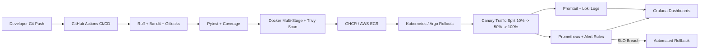

# PulseTrack — End-to-End DevOps Automation Platform

**PulseTrack** is a production-ready, cloud-native Task & Incident Telemetry platform built to demonstrate a complete Software Delivery Lifecycle (SDLC) — from version control and automated CI/CD security gates to multi-stage containerization, Kubernetes orchestration, Infrastructure as Code (Terraform + Ansible), observability (Prometheus, Grafana, Loki), and progressive Canary/Blue-Green deployments with automated rollback.

---

## Architecture Overview



---

## Repository Structure

```text
Capstone_devops/
├── .github/workflows/
│   ├── ci-cd.yml                  # Lint, SAST, Gitleaks, Pytest, Docker, Trivy, Canary Deploy
│   └── terraform-validate.yml     # IaC formatting & validation workflow
├── app/
│   ├── main.py                    # FastAPI app, JSON logging, Prometheus metrics, health probes
│   ├── requirements.txt
│   └── requirements-dev.txt
├── tests/
│   └── test_app.py                # Unit & integration tests
├── k8s/
│   ├── base/                      # Namespace, Deployment, Service, Ingress, RBAC, HPA, PDB, NetworkPolicy
│   ├── overlays/
│   │   ├── staging/               # Staging Kustomize overlay
│   │   └── production/            # Production Kustomize overlay
│   └── canary/
│       └── rollout.yaml           # Argo Rollouts Canary + Prometheus AnalysisTemplate
├── infra/
│   ├── terraform/                 # AWS VPC, Private Subnets, ECR, Security Groups
│   └── ansible/                   # Server hardening (UFW, fail2ban), Docker & Node Exporter
├── observability/
│   ├── nginx/canary.conf          # Weighted Blue/Green Canary router (80/20 split)
│   ├── prometheus/                # Scrape config & SLO alert rules
│   ├── grafana/                   # Provisioned datasources & PulseTrack JSON dashboard
│   ├── loki/                      # Loki storage & schema config
│   └── promtail/                  # JSON log pipeline for Loki
├── samples/
│   ├── app-sample.log             # Sample structured JSON logs
│   └── sample-payloads.json       # Sample API request payloads
├── scripts/
│   ├── canary-switch.ps1          # PowerShell helper to shift Blue/Green traffic weights
│   ├── canary_sim.py              # Progressive Canary & auto-rollback simulator
│   ├── generate_report_pdf.py     # Builds docs/CAPSTONE_REPORT.pdf with screenshots
│   └── render_terminal_screenshots.py
├── security/
│   └── secret_guard.py            # Secret scanner & log masking verifier
├── dr/
│   └── backup_restore.ps1         # Snapshot backup, verify & restore automation
├── screenshots/                   # Verification & live execution screenshots
├── docs/
│   └── CAPSTONE_REPORT.md         # Full Capstone documentation (Problem, Design, Evidence, Results)
├── Dockerfile                     # Multi-stage, non-root, OCI-labeled container image
├── docker-compose.yml             # Full local stack (Blue, Green, Nginx, Prometheus, Grafana, Loki)
└── pytest.ini
```

---

## Execution Steps

### 1. Local Python Development & Automated Tests
```powershell
python -m venv .venv
.\.venv\Scripts\Activate.ps1
pip install -r app/requirements.txt -r app/requirements-dev.txt

# Run tests with coverage
pytest --cov=app --cov-report=term-missing

# Run linting & SAST security checks
ruff check app tests
bandit -r app -ll
```

### 2. Full Local Observability & Canary Stack (Docker Compose)
```powershell
docker compose up -d --build
```
Once running:
- **Canary Router (80% Blue / 20% Green)**: `http://localhost:8080`
- **Blue Track (v1.0.0)**: `http://localhost:8001`
- **Green Canary Track (v1.1.0-canary)**: `http://localhost:8002`
- **Prometheus**: `http://localhost:9090`
- **Grafana**: `http://localhost:3000` (default: `admin` / `admin`)
- **Loki**: `http://localhost:3100`

Shift Canary traffic dynamically (e.g., 50% Canary, or 0% to rollback):
```powershell
.\scripts\canary-switch.ps1 -CanaryWeight 50
.\scripts\canary-switch.ps1 -CanaryWeight 0
```

### 3. Kubernetes Deployment (Kustomize + Argo Rollouts)
```powershell
# Preview rendered manifests
kubectl kustomize k8s/overlays/staging
kubectl kustomize k8s/overlays/production

# Apply to cluster
kubectl apply -k k8s/overlays/production
kubectl apply -f k8s/canary/rollout.yaml
```

### 4. Infrastructure Automation (Terraform & Ansible)
```bash
# Terraform (AWS VPC, Subnets, ECR, Security Groups)
cd infra/terraform
terraform init
terraform fmt -check
terraform validate
terraform plan

# Ansible (Node hardening + Node Exporter)
cd ../ansible
ansible-playbook -i inventory.ini site.yml --check
```

---

## API Endpoints

| Endpoint | Method | Description |
| :--- | :--- | :--- |
| `/` | `GET` | Built-in live status dashboard |
| `/health/live` | `GET` | Kubernetes liveness probe |
| `/health/ready` | `GET` | Kubernetes readiness probe |
| `/api/v1/version` | `GET` | Service version & deployment track (`blue` / `green-canary`) |
| `/api/v1/tasks` | `GET`, `POST` | List or create operational tasks |
| `/api/v1/tasks/{id}` | `PATCH`, `DELETE` | Update or remove a task |
| `/api/v1/incidents` | `GET`, `POST` | List or report service incidents |
| `/metrics` | `GET` | Prometheus exposition endpoint |
